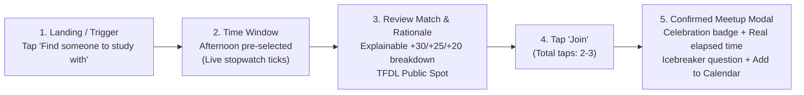

# CampusBuddy — Design System & Component Specifications
**Event:** UXDC Designathon 2026 (University of Calgary UI/UX Club)  
**Track:** Experienced Track  
**Role:** Canonical design specification for developer handoff and Figma design system creation  

---

## 1. Visual Design Philosophy & Principles

CampusBuddy is built around **low-pressure human connection**. Unlike traditional social networks that induce anxiety through endless feeds, vanity metrics (followers, likes), and ambiguous messaging, CampusBuddy uses design to lower social friction:

1. **Warm & Calm Atmosphere:** Clean, campus-grounded palettes (Deep Pine, Warm Sun, Slate Ink) that evoke safety and approachable optimism rather than sensory overload.
2. **Speed & Clarity (The 90-Second Promise):** Clear visual hierarchy, generous touch targets, and instant feedback. Micro-interactions guide students from loneliness to a confirmed public meetup in two or three taps.
3. **Radical Transparency:** No black-box AI or hidden algorithms. Every match percentage is accompanied by plain-language bullet points explaining exactly why two students or moments were paired.
4. **Psychological Safety by Default:** General, well-lit, public campus landmarks only; no private dorm numbers or personal phone handles; clear blocking and reporting tools.

---

## 2. Design Tokens

### 2.1 Color Palette & Contrast Tokens

All text and UI component combinations strictly adhere to **WCAG 2.2 AA standards** (minimum 4.5:1 for normal text, 3:1 for large text and UI components).

```css
/* ==========================================================================
   DARK MODE TOKENS (Default Aesthetic — Linear / Obsidian Grey & Black)
   ========================================================================== */
:root, :root[data-theme="dark"] {
  /* Surfaces: Layered Obsidian & Charcoal */
  --bg:           #090a0f; /* Deep obsidian canvas */
  --bg-subtle:     #0d0f15; /* Sub-surface background */
  --card:          #13161f; /* Surface card */
  --card-hover:    #181c28; /* Hover card surface */
  --card-muted:    #161924; /* Inset container surface */
  --card-elevated: #1e2230; /* Elevated dialog surface */

  /* Hairline Borders & Luminous Dividers */
  --line:          rgba(255, 255, 255, 0.08); /* Luminous subtle border */
  --line-subtle:   rgba(255, 255, 255, 0.04); /* Inset divider */
  --line-glow:     rgba(255, 255, 255, 0.16); /* Border hover highlight */

  /* High-Contrast Zinc Typography (WCAG AAA) */
  --ink:           #f8fafc; /* Crisp white headers (16.5:1 contrast) */
  --ink-secondary: #cbd5e1; /* Clear silver body text (11.2:1 contrast) */
  --mut:           #94a3b8; /* Muted zinc metadata (6.8:1 contrast) */
  --mut-dim:       #64748b; /* Subtle captions */

  /* Primary Brand Accent (Luminescent Titanium & Raycast Cyan) */
  --pine:          #f8fafc; /* Titanium white CTA */
  --pine-hover:    #ffffff;
  --pine-subtle:   rgba(255, 255, 255, 0.08);
  --pine-border:   rgba(255, 255, 255, 0.18);
  --onp:           #090a0f; /* Jet black ink on primary CTA */

  /* Semantic Feedback */
  --green:         #10b981; /* Emerald active pulse */
  --green-subtle:  rgba(16, 185, 129, 0.12);
  --green-glow:    0 0 10px rgba(16, 185, 129, 0.45);
  --sun:           #f59e0b; /* Amber warning / timer */
  --sun-subtle:    rgba(245, 158, 11, 0.12);
  --sun-ink:       #fef3c7;
  --red:           #f43f5e; /* Rose danger */
  --red-subtle:    rgba(244, 63, 94, 0.12);
  --red-ink:       #ffe4e6;
}

/* ==========================================================================
   LIGHT MODE TOKENS (Minimalist Studio Slate)
   ========================================================================== */
:root[data-theme="light"] {
  --bg:            #f8fafc;
  --card:          #ffffff;
  --card-muted:    #f1f5f9;
  --line:          #e2e8f0;
  --line-subtle:   #f1f5f9;

  --ink:           #0f172a;
  --ink-secondary: #334155;
  --mut:           #64748b;

  --pine:          #0f172a;
  --pine-hover:    #1e293b;
  --pine-subtle:   #f1f5f9;
  --onp:           #ffffff;

  --sun:           #d97706;
  --sun-subtle:    #fef3c7;
  --sun-ink:       #78350f;
  --green:         #059669;
  --green-subtle:  #d1fae5;
  --red:           #e11d48;
  --red-subtle:    #ffe4e6;
  --red-ink:       #881337;
}
```

---

### 2.2 Typography Scale

- **Display & Headings:** `Bricolage Grotesque`, sans-serif (weights: 700 Bold, 800 ExtraBold). Punchy, geometric, expressive human tone.
- **Body & Controls:** `Figtree`, system-ui, sans-serif (weights: 400 Regular, 500 Medium, 600 SemiBold, 700 Bold). Clean legibility across high-density mobile displays.

| Token | Family | Size | Weight | Line Height | Usage |
|---|---|---|---|---|---|
| `font-hero` | Bricolage Grotesque | 36px – 54px | 800 | 1.12 | Landing hero banner headline |
| `font-h1` | Bricolage Grotesque | 28px – 34px | 800 | 1.15 | Page titles, primary modal headers |
| `font-h2` | Bricolage Grotesque | 22px – 26px | 700 | 1.20 | Section headers, card titles |
| `font-h3` | Bricolage Grotesque | 17px – 19px | 700 | 1.25 | Sub-group titles, attendee headers |
| `font-body-lg` | Figtree | 17px – 18px | 400 / 500 | 1.45 | Subtitles, hero intros |
| `font-body` | Figtree | 15px – 16px | 400 / 500 | 1.50 | Standard body copy, descriptions |
| `font-body-sm` | Figtree | 13.5px – 14px | 500 / 600 | 1.40 | Form labels, secondary card metadata |
| `font-caption`| Figtree | 11.5px – 12.5px| 600 / 700 | 1.30 | Status chips, time slot badges, small counters |

---

### 2.3 Spacing & Layout Tokens

- **Grid System:** 8pt base grid with 4pt half-step for micro-alignment.
- `space-1`: 4px
- `space-2`: 8px
- `space-3`: 12px
- `space-4`: 16px
- `space-5`: 20px
- `space-6`: 24px
- `space-8`: 32px
- `space-12`: 48px

**Border Radius:**
- `radius-sm`: 8px (input fields, small chips)
- `radius-md`: 12px (buttons, timing callouts)
- `radius-lg`: 18px (content cards, modal dialogs)
- `radius-full`: 9999px (capsule buttons, badges, category chips)

**Shadows:**
- `shadow-sm`: `0 1px 2px rgba(13, 30, 38, 0.05)`
- `shadow-md`: `0 4px 12px rgba(13, 30, 38, 0.08)`
- `shadow-lg`: `0 12px 28px rgba(13, 30, 38, 0.12)`

---

## 3. Component Library Specifications

### 3.1 Primary Action Buttons (`.btn`)
- **Default State:** Solid background (`--pine`), text color (`--onp`), height: 44px (touch accessible), border-radius: 12px.
- **Hover State:** Background darkens to `--pine-hover`, subtle shadow lift.
- **Pressed / Active State:** Transform `scale(0.98)` for tactile micro-feedback.
- **Disabled State:** Opacity 0.55, cursor not-allowed, transform disabled.
- **Focus State:** 3px outline (`--sun`) with 2px offset.

### 3.2 Secondary / Ghost Buttons (`.btn.g`)
- **Default State:** Transparent background, 1.5px solid border (`--pine`), text color (`--pine`).
- **Hover State:** Background transitions to `--pine-subtle`.
- **Active State:** Transform `scale(0.98)`.

### 3.3 Destructive Buttons (`.btn.r`)
- **Default State:** Solid background (`--red`), text color `#ffffff`.
- **Hover State:** Background `#991b1b`.

### 3.4 Interactive Chips (`button.chip`)
- **Default State:** Background `--card-muted`, border 1.5px solid `--line`, color `--ink-secondary`.
- **Selected / On State:** Background `--pine`, border-color `--pine`, color `--onp`, font-weight 700.
- **Hover State:** Border color shifts to `--pine`, background `--pine-subtle`.

### 3.5 Match Score Explainability Callout (`.fit-box`)
- **Layout:** Contained callout with a 3.5px solid left border (`--pine`) and tinted background (`--pine-subtle`).
- **Content:**
  - Header: Percentage fit (e.g. `85% Match Score · Design defaults`).
  - Bulleted List: Plain-language breakdown citing specific matching criteria (+30 Activity, +25 Time, +20 Topic, +15 Same Major, +10 Interaction Style).

### 3.6 Verified Campus Meeting Point Badge (`.safe-point`)
- **Icon:** 📍 Location pin with green/pine tint.
- **Copy:** Specific public campus landmark (e.g. `Taylor Family Digital Library (TFDL), Level 2 Commons`).
- **Significance:** Assures both attendees that the meetup is situated in an open, monitored, well-lit campus space.

### 3.7 UXDC 2026 Judge Guided Tour Banner (`.judge-tour-banner`)
- **Purpose:** 1-tap evaluator orientation highlighting academic research, 90s sprint innovation, explainable matching, spatial radar map, and icebreaker roulette.
- **Visuals:** Gold crown accent, collapsible step navigation (`1. Research & Personas` to `5. Icebreaker Roulette`), and dynamic rubric evaluation callout cards (`.tour-callout-card`).

### 3.8 Interactive Campus Radar Map SVG (`.campus-map-container`)
- **Purpose:** Spatial awareness of University of Calgary campus public landmarks.
- **Visuals:** Architectural grid blueprint with Swann Mall green lawn, CTrain transit line, animated pulsating radar beacons, live moment counters, and an interactive Spot Detail Drawer with noise ratings, amenities, and 1-tap moment filtering/creation.

### 3.9 Campus Disconnection & Activity Vibe Timeline (`.vibe-timeline-wrapper`)
- **Purpose:** Addresses the 4 acute disconnection transition periods students face during the day.
- **Periods:**
  - 🌅 *Morning Focus (08:30 – 11:30 AM):* Quiet library desks, study groups, calculus revision.
  - 🥪 *Midday Collab (11:30 AM – 02:00 PM):* High social energy, lunch together at MacEwan Food Court.
  - 📚 *Study Sprint (02:00 – 05:00 PM):* Focused afternoon co-working & problem set prep.
  - 🌇 *Wind-Down (05:00 – 08:30 PM):* Golden-hour photo walks & tabletop board games.
- **Interactions:** 1-tap vibe filter buttons with active luminous border glow and real-time active student counters.

### 3.10 Spot Landmark Compass Meeting Guide (`.landmark-guide-card`)
- **Purpose:** Eliminates arrival anxiety by answering *"How do we find each other once we get there?"*
- **Visuals:** Exact meeting area directions, buddy recognition tips (e.g. *"Look for the study notepad or CampusBuddy web check-in on the table"*), noise level indicator, and amenity badges (⚡ Power outlets, 📶 Eduroam/AirUC-Secure Wi-Fi).

### 3.11 Dual Command Palette & Keyboard Shortcuts Studio (`.cmd-palette-box`)
- **Purpose:** Power-user accessibility inspired by Linear, Raycast, and Notion (`Cmd+K` / `Ctrl+K` / `?`).
- **Capabilities:** Instant fuzzy search to jump to tabs, start 90s sprints, toggle themes, switch sound effects, or switch simulated personas.

### 3.12 Dynamic Island / Live Activity Capsule (`.live-capsule-island`)
- **Purpose:** Persistent ambient awareness of confirmed upcoming meetups or active 90-second sprints.
- **Visuals:** Floating pill capsule with pulsating status dot, countdown timer, location tag, and 1-tap quick action buttons.

### 3.13 Student Persona Deep-Dive Sheet (`.profile-hero`, `.synergy-gauge`)
- **Purpose:** Rich inspection sheet for peer profiles.
- **Visuals:** Large initials avatar, online status indicator, academic schedule chips, study style badges, course overlap, and an algorithmic Peer Synergy gauge with 1-tap invitation sending.

### 3.14 Synthesized Web Audio Haptic Feedback Engine
- **Purpose:** Multi-sensory tactile feedback without bloated audio assets.
- **Implementation:** Web Audio API oscillator synthesis generating clean, subtle chimes for taps, modal openings, sprint confirmations, and confetti celebrations, with a 1-tap mute toggle.

---

## 4. The 90-Second Micro-Connection Interaction Pattern



### Key Interaction Details:
1. **Zero-Latency Stopwatch:** An active digital stopwatch ticks in the banner (`⏱️ 00:14s elapsed`) with a pulsing green indicator.
2. **Pre-calibrated Filters:** Based on student onboarding free-hours, the current open time window is automatically active.
3. **Single-Tap Commitment:** The highest-fit study session card is prominently framed with a gold/pine highlight. Tapping "Join this moment" immediately finalizes the spot without chat negotiations.
4. **Immediate Grounding Modal:** Presents who is attending, coordinates at a safe public landmark, an icebreaker conversation starter, and the exact measured elapsed time (e.g., "From 'nobody to study with' to a plan in 14 seconds").

---

## 5. Accessibility & Inclusivity Checklist (WCAG 2.2 AA)

- [x] **Color Contrast:** All body text meets or exceeds 4.5:1 ratio against card surfaces; all titles meet 7:1 ratio (AAA).
- [x] **Target Size:** All tap targets (buttons, filter chips, navigation items) meet minimum 44×44px dimensions.
- [x] **Focus Indicators:** High-contrast focus rings (`outline: 3px solid var(--sun); outline-offset: 2px`) on all interactive controls.
- [x] **Screen Reader Architecture:**
  - Semantic landmark tags (`<header>`, `<nav>`, `<main>`, `<dialog>`, `<article>`).
  - ARIA attributes: `aria-modal="true"`, `aria-labelledby`, `role="status"` on notification toasts.
  - `#live-region` politely announces dynamic status changes.
- [x] **Reduced Motion Support:** `@media (prefers-reduced-motion: reduce)` disables all CSS transitions and animations for motion-sensitive users.
- [x] **Responsive Adaptation:** Fluid single-column layout on mobile viewports (<480px), dual-column tile layout on tablets and desktop (>768px).

